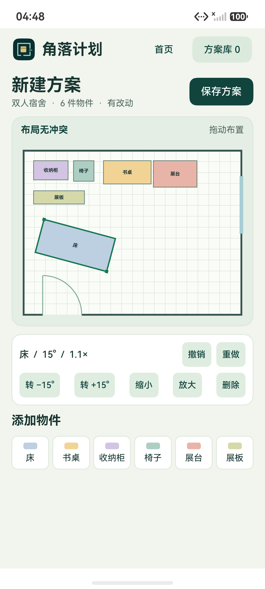
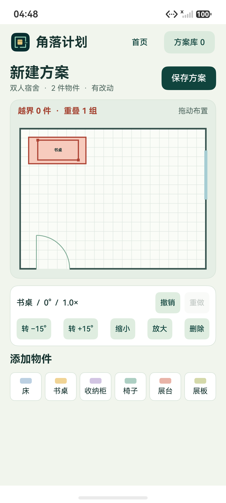
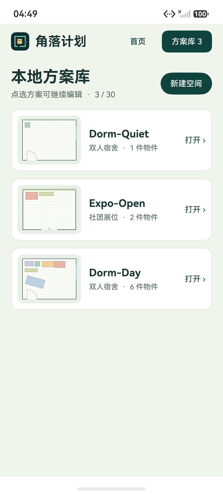

# 角落计划

主题二「空间造物局」的原生 HarmonyOS 应用。可以在双人宿舍或社团展位的二维底图上布置物件、检查冲突并保存在本地，之后从方案库打开继续编辑。

## 运行

使用 DevEco Studio 26.0.1.290、HarmonyOS SDK 26.0.1.120 Beta1（API 26）。工程配置最低兼容 API 12，本次在 Mate 90 Pro 模拟器（HarmonyOS 7.0.0.120）验证。

1. 将仓库放在简短的英文路径下，在 DevEco Studio 选择 **Open**，打开本目录并同步。首次安装 SDK 与 OhPM 依赖需联网，应用运行可离线。
2. 在 Device Manager 启动本地模拟器，选择 **entry** 并运行。也可用以下命令构建和安装到已启动的本机模拟器（按本机安装目录调整路径）。
3. 真机运行需在 DevEco Studio 中配置设备对应的调试签名。个人签名文件和 IDE 缓存无需提交。

```powershell
$deveco = 'F:\DevEco Studio'
$env:DEVECO_SDK_HOME = "$deveco\sdk"
$env:JAVA_HOME = "$deveco\jbr"
$env:Path = "$deveco\tools\node;$deveco\tools\ohpm\bin;$env:Path"
ohpm install --all
node "$deveco\tools\hvigor\bin\hvigorw.js" --mode module -p module=entry@default -p product=default assembleHap --no-daemon
$env:CORNER_HDC = "$deveco\sdk\default\openharmony\toolchains\hdc.exe"
& $env:CORNER_HDC -t 127.0.0.1:5555 install -r entry/build/default/outputs/default/entry-default-unsigned.hap
& $env:CORNER_HDC -t 127.0.0.1:5555 shell 'aa start -a EntryAbility -b com.coursework.cornerplan'
```

## 操作

| 操作 | 结果 |
| --- | --- |
| 在首页选择双人宿舍或社团展位 | 按不同场地边界、入口等绘制底图 |
| 点底部床、书桌、收纳柜、椅子、展台或展板 | 自动放置一个新物件，可重复添加同类 |
| 点选或拖动物件，使用旋转、缩放、删除工具 | 更新布局；松手后记录一次拖动，可撤销或重做 |
| 将物件拖出边界或叠在另一件上 | 物件标红；重叠达到较小面积的 20% 时提示，边缘接触允许 |
| 输入名称并确认保存 | 写入本地方案库，保留最多 30 份命名方案 |
| 从方案库打开缩略图 | 查看并继续编辑，原方案保存后按同一 ID 更新 |

版式单位为画布坐标。恢复的是已命名保存的布局和方案列表。编辑会话的撤销/重做历史在打开方案时重新开始。应用为单设备离线编辑，布局冲突可作为草案保存。

## 测试与记录

- `node scripts/test-core.mjs` 运行 12 条核心用例，要求 Node.js 22.13 或以上，已在 Node.js 24.12.0 执行。脚本对 ArkTS 业务源码做类型擦除，覆盖正常、边界和异常，输出 [核心测试记录](evidence/core-results.json)。`entry/src/test/List.test.ets` 是相同核心用例的 Hypium 本地测试入口。
- `node scripts/test-native.mjs` 通过 hdc 驱动 Mate 90 Pro 模拟器，输出 [原生验收记录](evidence/native-results.json) 和截图。需要已安装本应用、方案库为空、系统输入法已初始化。脚本会在测试实例中建立三份方案，结束应用进程并重新打开。可用 `CORNER_HDC`、`CORNER_DEVICE`、`CORNER_DENSITY` 指定 CLI 路径、设备和密度。
- [原生构建日志](evidence/build.log)及[实际演示录屏](evidence/demo.mp4)记录了编译与模拟器操作。视频在 Windows 使用支持 `gfxcapture` 的 FFmpeg 捕获模拟器窗口。

<p></p>

## 源码与需求

- [软件需求说明书](docs/软件需求说明书.md)
- `entry/src/main/ets/pages` 工作台、方案库、界面状态及 Canvas 绘制。
- `entry/src/main/ets/domain` 场地和物件模型、命中与几何规则、编辑历史。
- `entry/src/main/ets/data` 方案校验、仓储和 Preferences 平台适配。
- `entry/src/test` 用例输入、Mock、断言和 Hypium 入口。
- `scripts` 本机核心、模拟器与录屏脚本。
